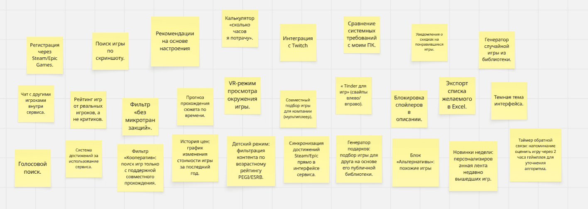
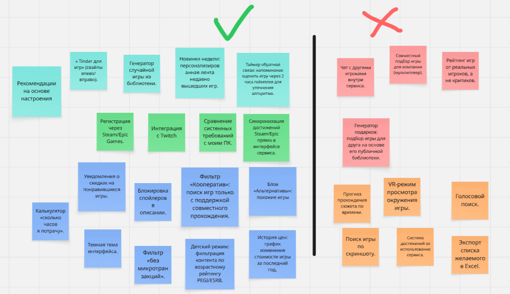

# Отчёт по самостоятельной работе №4 «Выявление функциональных требований методом мозгового штурма»

**Министерство образования РФ**  
**ФГБОУ ВО «РГРТУ»**

**Отчет составил:**  
Студент группы 6413  
Панченко Артём

---

### 1. Описание проведения мозгового штурма

*   **Тема:** Генерация функций для веб-сервиса подбора компьютерных.
*   **Участники:** Команда проекта (5 человек):
    *   Панченко Артём (Руководитель, модератор)
    *   Екатерина Папазян (Программист)
    *   Трофим Орлов (Специалист по данным)
    *   Алишер Наврузбеков (Архитектор ПО)
    *   Илья Подъяпольский (Специалист по тестированию)
*   **Формат:** Очная встреча с использованием онлайн-доски Miro для фиксации идей.
*   **Длительность:** 45 минут (10 мин — введение, 20 мин — генерация идей, 15 мин — группировка и отбор).
*   **Правила:**
    1.  Критика любых идей на этапе генерации строго запрещена.
    2.  Запрещено оценивать реализуемость или стоимость идеи до завершения этапа сбора.
    3.  Количество предложенных вариантов важнее их качества.
    4.  Приветствуется комбинирование и развитие чужих предложений.
    5.  Запрещено игнорировать предложения участников. Каждая идея должна быть зафиксирована.

*Рис. 1. Процесс генерации идей на онлайн-доске*

---

### 2. Полный список сгенерированных идей (без отбора)

В ходе командного мозгового штурма были предложены следующие функции:

1.  Регистрация через Steam/Epic Games.
2.  Поиск игры по скриншоту.
3.  Рекомендации на основе настроения («хочу расслабиться», «хочу потеть»).
4.  Калькулятор «сколько часов я потрачу».
5.  Интеграция с Twitch (смотреть стримы перед покупкой).
6.  Сравнение системных требований с моим ПК.
7.  « Tinder для игр» (свайпы влево/вправо).
8.  Уведомления о скидках на понравившиеся игры.
9.  Генератор случайной игры из библиотеки.
10. Чат с другими игроками внутри сервиса.
11. Рейтинг игр от реальных игроков, а не критиков.
12. Фильтр «без микротранзакций».
13. Прогноз прохождения сюжета по времени.
14. VR-режим просмотра окружения игры.
15. Совместный подбор игры для компании (мультиплеер).
16. Блокировка спойлеров в описании.
17. Экспорт списка желаемого в Excel.
18. Темная тема интерфейса.
19. Голосовой поиск.
20. Система достижений за использование сервиса.
21. Фильтр «Кооператив»: поиск игр только с поддержкой совместного прохождения.
22. История цен: график изменения стоимости игры за последний год.
23. Детский режим: фильтрация контента по возрастному рейтингу PEGI/ESRB.
24. Синхронизация достижений Steam/Epic прямо в интерфейсе сервиса.
25. Генератор подарков: подбор игры для друга на основе его публичной библиотеки.
26. Блок «Альтернативы»: похожие игры, если рекомендуемая не подходит по цене или требованиям.
27. Новинки недели: персонализированная лента недавно вышедших игр.
28. Таймер обратной связи: напоминание оценить игру через 2 часа геймплея для уточнения алгоритма.
---

### 3. Результат группировки и отбора идей

После этапа генерации идеи были объединены в тематические группы и оценены по следующим критериям: **ценность для целевой аудитории**, **техническая возможность реализации в рамках учебного проекта** и **соответствие техническому заданию**.

| Группа | Идеи (из п. 2) | Статус | Обоснование решения |
| :--- | :--- | :--- | :--- |
| **Персонализация** | Рекомендации на основе настроения («хочу расслабиться», «хочу потеть»), «Tinder для игр» (свайпы влево/вправо), Генератор случайной игры из библиотеки, Новинки недели: персонализированная лента недавно вышедших игр, Таймер обратной связи: напоминание оценить игру через 2 часа геймплея |  Принято | Является основной отличительной особенностью сервиса. Непосредственно решает проблему выбора и позволяет обучать алгоритм рекомендаций. |
| **Интеграции** | Регистрация через Steam/Epic Games, Интеграция с Twitch (смотреть стримы перед покупкой), Сравнение системных требований с моим ПК, Синхронизация достижений Steam/Epic прямо в интерфейсе сервиса |  Принято | Необходимо для получения достоверных данных о пользователе и проверки совместимости оборудования. |
| **Социальные функции** | Чат с другими игроками внутри сервиса, Совместный подбор игры для компании (мультиплеер), Рейтинг игр от реальных игроков, а не критиков, Генератор подарков: подбор игры для друга на основе его публичной библиотеки |  Отклонено | Высокий риск некорректного общения пользователей и сложность технической поддержки. Реализация данных функций выходит за рамки текущего технического задания и ресурсов команды. |
| **Вспомогательные инструменты** | Калькулятор «сколько часов я потрачу», Уведомления о скидках на понравившиеся игры, Блокировка спойлеров в описании, История цен: график изменения стоимости игры за последний год, Фильтр «Кооператив»: поиск игр только с поддержкой совместного прохождения, Блок «Альтернативы»: похожие игры, если рекомендуемая не подходит по цене или требованиям, Детский режим: фильтрация контента по возрастному рейтингу PEGI/ESRB, Фильтр «без микротранзакций», Темная тема интерфейса |  Принято | Существенно повышают удобство использования сервиса при относительно низкой сложности разработки. Темная тема является стандартом UX для игровой аудитории. |
| **Избыточные / Второстепенные функции** | Поиск игры по скриншоту, VR-режим просмотра окружения игры, Голосовой поиск, Экспорт списка желаемого в Excel, Система достижений за использование сервиса |  Отклонено | Технологически сложно реализовать в рамках учебного прототипа (поиск по скриншоту, VR) или имеет низкую ценность для MVP (экспорт в Excel, внутренние достижения сервиса). Не решают ключевые проблемы ЦА на этапе запуска. |

*Рис. 2. Карта идей после объединения в группы и фильтрации*

---

### 4. Итоговый перечень функциональных требований

На основе отобранных идей сформирован следующий список требований к прототипу веб-сервиса «На Ходу»:

1.  **Требование №01. Авторизация и профиль.** Система должна обеспечивать вход через аккаунты Steam или Epic Games для импорта библиотеки игр и синхронизации достижений пользователя.
2.  **Требование №02. Контекстная рекомендация.** Алгоритм должен предлагать игры на основе выбранного пользователем эмоционального запроса («расслабиться») и персонализированной ленты новинок.
3.  **Требование №03. Интерактивный выбор.** Реализовать интерфейс бинарного выбора (лайк/дизлайк) для обучения рекомендательной модели предпочтений пользователя.
4.  **Требование №04. Проверка совместимости.** Сервис обязан автоматически сравнивать системные требования рекомендуемой игры с конфигурацией ПК пользователя.
5.  **Требование №05. Детализация контента.** Карточка игры должна содержать среднее время прохождения сюжета, информацию о наличии микротранзакций, историю изменения цен и блок похожих альтернатив.
6.  **Требование №06. Трекер цен.** Пользователь должен иметь возможность подписаться на изменение цены конкретной игры из списка желаемого.
7.  **Требование №07. Безопасность контента.** Текстовое описание сюжета должно быть скрыто под интерактивным предупреждением по умолчанию; предусмотрен детский режим фильтрации контента по возрастному рейтингу.
8.  **Требование №08. Случайный выбор.** Наличие функции мгновенного подбора игры из текущего отфильтрованного списка.
9.  **Требование №09. Обратная связь.** Система должна запрашивать оценку игры после определённого времени геймплея для корректировки дальнейших рекомендаций.
10. **Требование №10. Социальные фильтры.** Возможность поиска игр исключительно с поддержкой кооперативного режима (локального или онлайн).

---

### 5. Вывод о соотношении требований с потребностями аудитории

Сформированный перечень функциональных требований напрямую закрывает ключевые боли трёх целевых сегментов, выявленных в самостоятельной работе №3:

1.  **Для школьников и подростков:**
    *   Потребность в социальном одобрении и бесплатном контенте закрыта **Требованием №10** (фильтр кооператива) и интеграцией с игровыми платформами (**Требование №01**), позволяющей видеть активность друзей.
    *   Ожидание быстрого результата «здесь и сейчас» реализовано через **Требование №08** (случайный выбор) и **Требование №03** (интерактивный свайп), что соответствует привычному паттерну поведения поколения Z.

2.  **Для студентов:**
    *   Страх потратить ограниченный бюджет на «разочарование» устранён **Требованием №06** (трекер цен) и **Требованием №04** (проверка совместимости), гарантирующим техническую безопасность покупки.
    *   Запрос на уникальные инди-игры без спойлеров удовлетворён **Требованием №02** (контекстная рекомендация по настроению) и **Требованием №07** (защита контента), что создаёт доверие к алгоритмам сервиса.

3.  **Для работающих взрослых и родителей:**
    *   Критический дефицит времени компенсирован **Требованием №05** (детализация с временем прохождения) и **Требованием №09** (обратная связь), позволяя быстро отсеивать слишком длинные проекты.
    *   Потребность в безопасном семейном досуге обеспечена **Требованием №07** (детский режим) и **Требованием №10** (поиск кооператива), превращая сервис в инструмент планирования отдыха.

Таким образом, итоговый набор из 10 функциональных требований не является абстрактным списком возможностей, а представляет собой точечное решение конкретных жизненных задач каждого сегмента ЦА. Отказ от сложных социальных функций (чатов, генераторов подарков) обоснован тем, что они не решают первичных болей ни одной из персон на этапе запуска, но создают риски токсичности, особенно критичные для подросткового сегмента. Приоритет отдан инструментам экономии времени, финансовой прозрачности и персонализации, что формирует устойчивую ценность продукта для всех возрастных групп.
