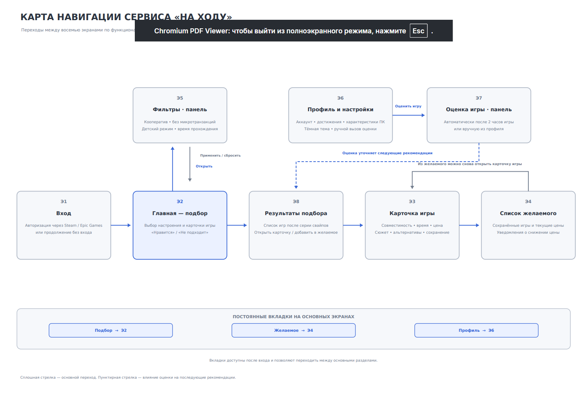
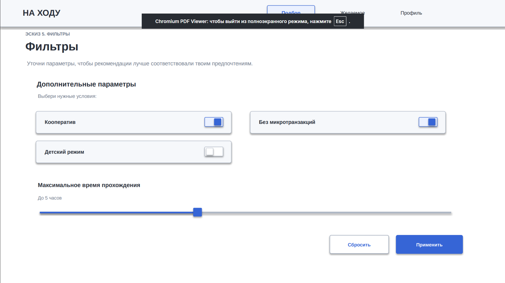

# Отчёт по самостоятельной работе №5 «Разработка интерфейса»

**Министерство образования РФ**  
**ФГБОУ ВО «РГРТУ»**

**Отчет составил:**  
Студент группы 6413  
Панченко Артём

---

### 1. Перечень экранов и их назначение

Перечень составлен на основе функциональных требований, выявленных в самостоятельной работе №4. Количество экранов сведено к минимуму: восемь страниц вместо отдельных разделов под каждую функцию. Причина такого решения — ограниченные сроки реализации. Настройки, фильтры и списки вынесены во всплывающие панели поверх основного экрана, что убирает необходимость верстать отдельные страницы.

| № | Экран | Назначение | Закрываемые требования |
| :--- | :--- | :--- | :--- |
| Э1 | Вход | Авторизация через Steam или Epic Games, кнопка гостевого входа без регистрации | №01 |
| Э2 | Главная (подбор) | Выбор настроения одной кнопкой из четырёх, карточка игры со свайпом влево и вправо, кнопки «Случайная игра» и «Новинки недели» | №02, №03, №08 |
| Э3 | Карточка игры | Полные сведения об игре: время прохождения, метка о микротранзакциях, история цен, блок похожих альтернатив, скрытое описание сюжета, проверка совместимости с ПК | №04, №05, №07 |
| Э4 | Список желаемого | Сохранённые игры, переключатель уведомления о снижении цены, переход в карточку | №06 |
| Э5 | Фильтры (панель) | Переключатели: кооператив, без микротранзакций, детский режим, ограничение по времени прохождения | №05, №07, №10 |
| Э6 | Профиль и настройки | Данные аккаунта, синхронизация достижений, характеристики ПК, тёмная тема, повторный запрос оценки игры | №01, №04, №09 |
| Э7 | Оценка игры (панель) | Появляется после двух часов геймплея, предлагает поставить оценку и уточняет дальнейшие рекомендации | №09 |
| Э8 | Результаты подбора | Список игр после серии свайпов, кнопки сохранения в желаемое и возврата к подбору | №02, №03, №06 |

---

### 2. Состав элементов основных экранов

#### Э1. Вход
| Элемент | Назначение |
| :--- | :--- |
| Логотип и название сервиса | Узнаваемость, ориентир на первой странице |
| Кнопка «Войти через Steam» | Основной способ авторизации, импорт библиотеки |
| Кнопка «Войти через Epic Games» | Альтернативный способ авторизации |
| Ссылка «Продолжить без входа» | Снижение порога входа для подростковой аудитории, подбор без импорта библиотеки |

#### Э2. Главная (подбор)
| Элемент | Назначение |
| :--- | :--- |
| Четыре крупные кнопки настроения | Задание эмоционального запроса: расслабиться, испытать себя, сюжет, компания |
| Карточка игры (обложка, название, жанр, цена) | Единица выбора, помещается на экран целиком |
| Кнопки «Не подходит» и «Нравится» | Бинарный выбор, обучение рекомендаций; свайп поддержан как жест, но дублируется кнопками |
| Кнопка «Случайная игра» | Мгновенный подбор при нежелании выбирать |
| Кнопка «Новинки недели» | Переключение ленты на свежие релизы |
| Кнопка «Фильтры» | Открытие панели Э5 поверх экрана |
| Нижняя панель из трёх вкладок | Переходы: Подбор, Желаемое, Профиль |

#### Э3. Карточка игры
| Элемент | Назначение |
| :--- | :--- |
| Обложка и заголовок | Опознание игры |
| Строка совместимости («Пойдёт на вашем ПК» / «Слабый ПК») | Результат автоматического сравнения требований |
| Метки: время прохождения, кооператив, микротранзакции, возрастной рейтинг | Быстрая оценка пригодности без чтения текста |
| График истории цен | Понимание выгодности текущей цены |
| Кнопка «Следить за ценой» | Подписка на снижение стоимости |
| Блок описания под кнопкой «Показать сюжет» | Защита от спойлеров, текст скрыт по умолчанию |
| Три плитки похожих альтернатив | Замена при неподходящей цене или требованиях |
| Кнопка «В желаемое» | Сохранение игры |
| Кнопка «Назад» | Возврат к подбору |

#### Э4. Список желаемого
| Элемент | Назначение |
| :--- | :--- |
| Строка игры (обложка, название, текущая цена) |Compactный обзор сохранённого |
| Переключатель уведомления | Включение слежения за ценой по каждой игре |
| Метка снижения цены | Отображение выгоды |
| Кнопка удаления | Уборка неактуальных позиций |

#### Э5. Фильтры (панель)
| Элемент | Назначение |
| :--- | :--- |
| Переключатель «Кооператив» | Отбор игр для совместного прохождения |
| Переключатель «Без микротранзакций» | Отсечение игр с агрессивной монетизацией |
| Переключатель «Детский режим» | Ограничение по возрастному рейтингу |
| Ползунок времени прохождения | Отбор игр под доступный вечер |
| Кнопки «Применить» и «Сбросить» | Управление состоянием отбора |

#### Э6. Профиль и настройки
| Элемент | Назначение |
| :--- | :--- |
| Имя и аватар аккаунта | Подтверждение выполненного входа |
| Блок достижений | Синхронизированный прогресс из игровой платформы |
| Поля характеристик ПК | Основа для проверки совместимости |
| Переключатель тёмной темы | Стандарт оформления для игровой аудитории |
| Кнопка «Оценить пройденное» | Ручной вызов панели Э7 |

---

### 3. Карта навигации

Переходы между экранами организованы по схеме с тремя постоянными вкладками. Возврат из карточки игры всегда ведёт на предыдущий экран, отдельной истории переходов не требуется.

*Рис. 1. Схема переходов между экранами сервиса*

Текстовое описание схемы:

---

### 4. Эскизы основных экранов

Эскизы выполнены в виде схематичных макетов с расположением блоков. Детальная прорисовка не выполнялась, поскольку задача этапа — согласовать структуру, а не финальное оформление.

*Рис. 2. Эскиз экрана входа (Э1)*

*Рис. 3. Эскиз главного экрана подбора (Э2)*

*Рис. 4. Эскиз карточки игры (Э3)*

*Рис. 5. Эскиз списка желаемого (Э4)*

*Рис. 6. Эскиз панели фильтров (Э5)*

*Рис. 7. Эскиз экрана профиля (Э6)*

Общие правила расположения для всех экранов: одна колонка по центру шириной до 480 пикселей, крупная основная кнопка внизу, нижняя панель навигации из трёх вкладок. Такое решение одинаково работает на телефоне и на большом экране, отдельная версия для настольных компьютеров не разрабатывается.

---

### 5. Обоснование решений интерфейса с опорой на целевую аудиторию

Решения проверены по трём сегментам, выделенным в самостоятельной работе №3.

**Школьники и подростки (12–17 лет).** Гостевой вход на Э1 убирает обязательную регистрацию, которая для этого сегмента является причиной отказа. Крупные кнопки настроения и бинарный выбор на Э2 дают результат за два действия, что соответствует привычному формату пролистывания. Метка о микротранзакциях и фильтр бесплатного контента отвечают ограниченной платёжеспособности.

**Студенты (18–24 года).** Панель фильтров Э5 и подробные метки на Э3 дают глубину отбора без перегрузки главной страницы. График истории цен и подписка на снижение стоимости закрывают страх потратить ограниченный бюджет неудачно. Скрытое описание сюжета сохраняет интерес к нарративным играм. Тёмная тема включена по умолчанию как ожидаемое оформление.

**Работающие взрослые и родители (25–45 лет).** Ползунок времени прохождения и метка длительности выведены на видное место, что позволяет отсеять длинные проекты сразу. Детский режим и фильтр кооператива решают задачу подбора игры для ребёнка. Минимум вложенных страниц и одна колонка сокращают количество действий до результата.

Отказ от отдельных страниц под каждый фильтр, от боковых меню и от многоколоночных сеток обоснован сроками. Все второстепенные функции собраны в две всплывающие панели, что уменьшает объём вёрстки примерно вдвое при сохранении полного набора требований из СР4.

---

### 6. Вывод

Спроектирован интерфейс из восьми экранов, покрывающий все десять функциональных требований, выявленных методом мозгового штурма. Определён состав элементов каждого основного экрана и схема переходов с тремя постоянными вкладками. Выбранная компоновка в одну колонку с всплывающими панелями вместо отдельных страниц обеспечивает простоту реализации в короткие сроки и одновременно учитывает различия трёх ключевых сегментов аудитории: скорость выбора для подростков, глубину фильтрации для студентов, экономию времени и безопасность контента для взрослых. Подготовленные эскизы служат прямой основой для сборки работающего прототипа на следующем этапе.

