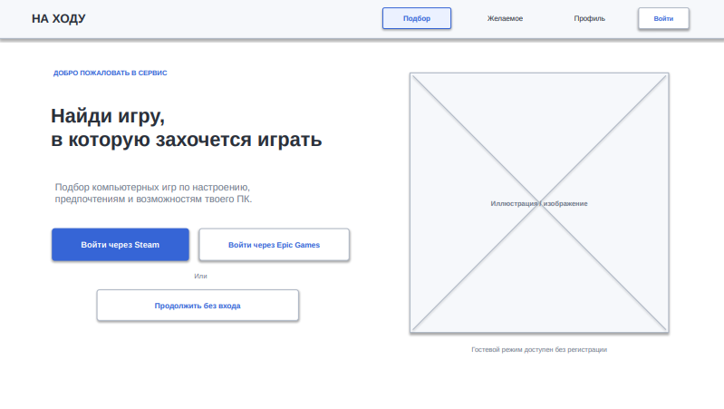
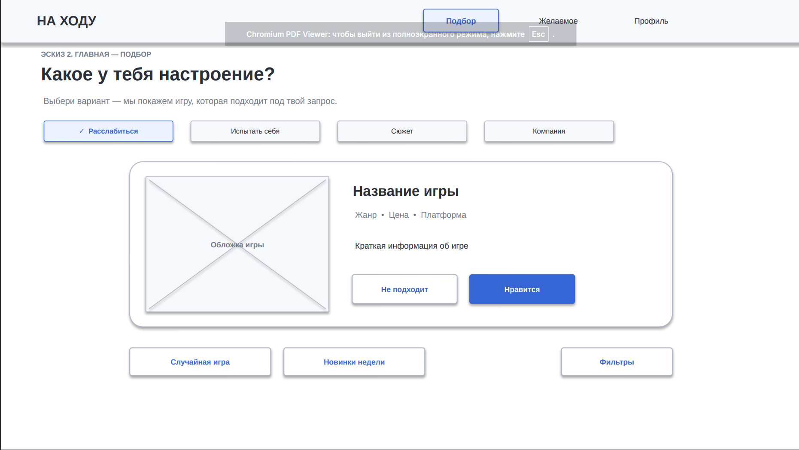
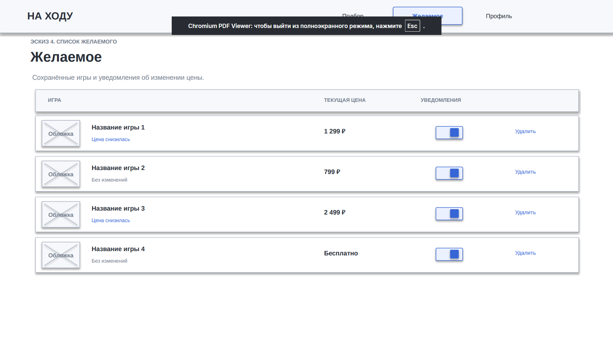
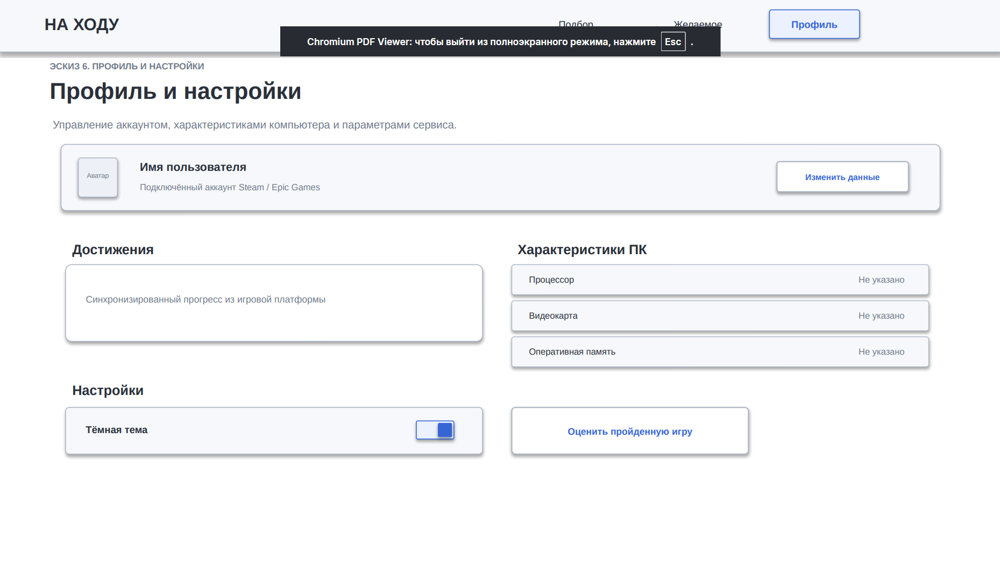
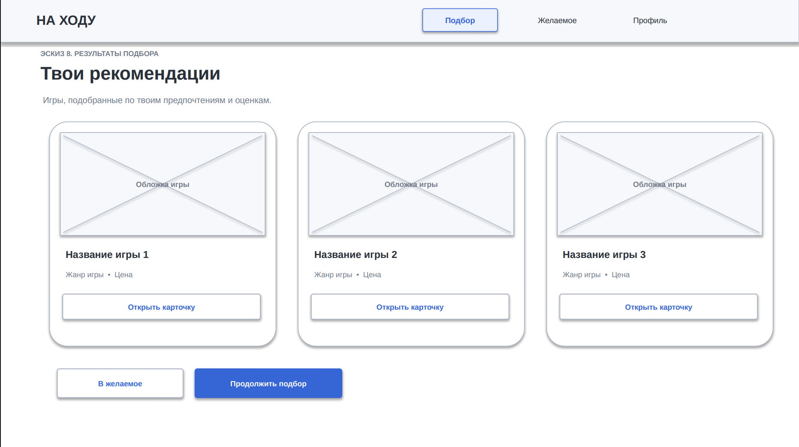

# Отчёт по самостоятельной работе №5 «Разработка интерфейса»

**Министерство образования РФ**  
**ФГБОУ ВО «РГРТУ»**

**Отчет составил:**  
Студент группы 6413  
Панченко Артём

---

### 1. Перечень экранов и их назначение

На основе функциональных требований, выявленных в самостоятельной работе №4, определён перечень из 8 основных экранов веб-сервиса «На Ходу». Интерфейс спроектирован для настольных браузеров с шириной рабочей области 1200–1440 пикселей. Навигация реализована через постоянную верхнюю панель, а управление параметрами поиска вынесено в левую боковую колонку, что позволяет видеть настройки и контент одновременно.

| № | Экран | Назначение | Закрываемые требования |
| :--- | :--- | :--- | :--- |
| Э1 | Вход | Авторизация через Steam/Epic Games или гостевой вход. Центральная карточка с приветствием и выбором способа входа. | №01 |
| Э2 | Главная (Подбор) | Выбор настроения, карточка игры с бинарным выбором («Нравится» / «Не подходит»), кнопки случайного выбора и новинок. Левая панель с фильтрами всегда видна. | №02, №03, №08 |
| Э3 | Карточка игры | Подробные сведения: совместимость с ПК, метки (время, кооператив, микротранзакции), история цен, скрытый сюжет, блок альтернатив. Две колонки: контент слева, действия справа. | №04, №05, №07 |
| Э4 | Список желаемого | Таблица сохранённых игр с текущей ценой, статусом уведомления и кнопкой удаления. Сортировка и подсчёт элементов. | №06 |
| Э5 | Фильтры | Боковая панель настроек: переключатели (кооператив, без микротранзакций, детский режим), ползунок времени прохождения, дополнительные параметры. | №05, №07, №10 |
| Э6 | Профиль и настройки | Управление аккаунтом, синхронизация достижений, характеристики ПК, тёмная тема, ручной вызов оценки игры. Две колонки: данные слева, настройки справа. | №01, №04, №09 |
| Э7 | Оценка игры | Модальное окно поверх основного контента. Запрос оценки после 2 часов геймплея, выбор параметров для улучшения рекомендаций. | №09 |
| Э8 | Результаты подбора | Сетка из 6 карточек подобранных игр (3 колонки × 2 ряда). Кнопки массового сохранения и продолжения подбора. | №02, №03, №06 |

---

### 2. Состав элементов основных экранов

#### Э1. Вход
| Элемент | Назначение |
| :--- | :--- |
| Верхняя панель (Header) | Логотип, название сервиса, пункты меню (неактивны до входа). |
| Центральная карточка | Контейнер для фокусировки внимания, белый фон на светлом фоне страницы. |
| Кнопки авторизации | «Войти через Steam», «Войти через Epic Games» — основные способы импорта данных. |
| Ссылка «Продолжить без входа» | Гостевой режим для снижения порога входа (важно для сегмента 12–17 лет). |

#### Э2. Главная (Подбор)
| Элемент | Назначение |
| :--- | :--- |
| Верхняя панель навигации | Переключение разделов: Подбор, Желаемое, Профиль. Активный пункт подчёркнут. |
| Левая боковая панель | Постоянно видимые фильтры: настроение, время прохождения, теги. Не требует открытия отдельного окна. |
| Блок настроения | 4 крупные кнопки-переключателя: Расслабиться, Испытать себя, Сюжет, Компания. |
| Карточка игры | Крупная обложка, название, жанр, цена, платформа. Центральный элемент взаимодействия. |
| Кнопки действий | «Не подходит» / «Нравится» — обучение алгоритма. Дублируют свайпы для десктопа. |
| Доп. кнопки | «Случайная игра», «Новинки недели» — альтернативные сценарии поиска. |

#### Э3. Карточка игры
| Элемент | Назначение |
| :--- | :--- |
| Хлебные крошки | Кнопка «← Назад к подбору» для быстрого возврата. |
| Левая колонка (Контент) | Обложка, заголовок, статус совместимости с ПК, метки характеристик, скрытый сюжет. |
| Правая колонка (Действия) | График истории цен, кнопка «Следить за ценой», основная кнопка «В желаемое». |
| Блок альтернатив | 3 вертикальные плитки похожих игр внизу правой колонки. Замена при несоответствии цены/ТХ. |

#### Э4. Список желаемого
| Элемент | Назначение |
| :--- | :--- |
| Заголовок и счётчик | «Желаемое» + количество сохранённых игр. |
| Таблица списка | Столбцы: Игра (обложка+название), Текущая цена, Уведомления (переключатель), Действие (удалить). |
| Статус цены | Метка «Цена снизилась» выделяет выгодные предложения цветом. |

#### Э5. Фильтры (Боковая панель)
| Элемент | Назначение |
| :--- | :--- |
| Заголовок панели | «Фильтры» + поясняющий текст. |
| Чекбоксы/Тогглы | Кооператив, Без микротранзакций, Детский режим. Быстрое включение/выключение. |
| Ползунок (Slider) | Максимальное время прохождения. Визуальный выбор диапазона. |
| Кнопки управления | «Сбросить» (возврат к дефолту) и «Применить» (фиксация выбора). |

#### Э6. Профиль и настройки
| Элемент | Назначение |
| :--- | :--- |
| Блок аккаунта | Аватар, имя, подключённая платформа, кнопка «Изменить данные». |
| Блок достижений | Синхронизированный прогресс из Steam/Epic. Мотивационный элемент. |
| Характеристики ПК | Поля: Процессор, Видеокарта, ОЗУ. Основа для проверки совместимости (FR-04). |
| Настройки сервиса | Тоггл «Тёмная тема», кнопка «Оценить пройденную игру». |

#### Э7. Оценка игры (Модальное окно)
| Элемент | Назначение |
| :--- | :--- |
| Затемнение фона | Фокусировка на окне оценки, блокировка основного интерфейса. |
| Информация об игре | Мини-обложка, название, контекст («после 2 часов игры»). |
| Рейтинг (Stars) | 5 звёзд для субъективной оценки понравившегося. |
| Теги обратной связи | «Больше похожих», «Меньше таких» — уточнение алгоритма без текста. |
| Кнопка отправки | Фиксация оценки и закрытие окна. |

#### Э8. Результаты подбора
| Элемент | Назначение |
| :--- | :--- |
| Заголовок раздела | «Твои рекомендации» + пояснение логики подбора. |
| Сетка карточек | 3 колонки × 2 ряда. Равномерное распределение пространства. |
| Содержимое карточки | Обложка, название, жанр, цена, кнопка «Открыть карточку». |
| Глобальные действия | «В желаемое» (сохранить все), «Продолжить подбор» (сброс и новый поиск). |

---

### 3. Карта навигации

Навигация построена по принципу «Hub & Spoke» с постоянной верхней панелью. Основные разделы доступны в один клик из любой точки сервиса. Всплывающие окна (оценка, фильтры) не меняют URL и сохраняют контекст предыдущего экрана.

*Рис. 1. Схема переходов между экранами сервиса*

**Логика переходов:**
1.  **Верхний уровень:** Э1 (Вход) → Э2/Э4/Э6 (через Header).
2.  **Внутри раздела «Подбор»:** Э2 ↔ Э5 (фильтры интегрированы), Э2 → Э3 (детали), Э2 → Э8 (результаты).
3.  **Детализация:** Э3 → Э3 (альтернативы), Э3 → Э4 (добавление в список).
4.  **Контекстные окна:** Э6 → Э7 (оценка), Э2 → Э5 (уточнение фильтров).
5.  **Возврат:** Кнопка «Назад» в Э3 и Э8 ведёт строго на Э2.

---

### 4. Эскизы основных экранов

Эскизы выполнены в виде полностраничных макетов для десктопного разрешения (1440px). Соблюдена единая сетка, типографика и стиль компонентов. Детальная прорисовка иллюстраций заменена заглушками для фокусировки на структуре.

*Рис. 2. Эскиз экрана входа (Э1)*

*Рис. 3. Эскиз главного экрана подбора (Э2)*

*Рис. 4. Эскиз карточки игры (Э3)*

*Рис. 5. Эскиз списка желаемого (Э4)*

*Рис. 6. Эскиз боковой панели фильтров (Э5)*

*Рис. 7. Эскиз экрана профиля и настроек (Э6)*

*Рис. 8. Эскиз модального окна оценки (Э7)*

*Рис. 9. Эскиз экрана результатов подбора (Э8)*

---

### 5. Обоснование решений интерфейса с опорой на целевую аудиторию

Проектные решения проверены на соответствие потребностям трёх ключевых сегментов, выявленных в СР3:

**Школьники и подростки (12–17 лет).**
*   *Гостевой вход (Э1)* устраняет барьер регистрации.
*   *Крупные кнопки настроения (Э2)* и понятные метки («Без микротранзакций») соответствуют клиповому мышлению и ограничению бюджета.
*   *Отсутствие сложных таблиц* на главном экране снижает когнитивную нагрузку.

**Студенты (18–24 года).**
*   *Боковая панель фильтров (Э2/Э5)* позволяет тонко настраивать поиск без потери контекста просмотра.
*   *График истории цен (Э3)* и таблица желаемого (Э4) дают инструменты для рациональной покупки.
*   *Тёмная тема (Э6)* реализована как базовая опция, ожидаемая этой аудиторией.

**Работающие взрослые и родители (25–45 лет).**
*   *Ползунок времени прохождения (Э5)* и метка длительности (Э3) решают проблему дефицита времени.
*   *Детский режим и фильтр кооператива* вынесены на видное место для быстрого поиска семейного досуга.
*   *Чёткая структура таблицы (Э4)* и сетки результатов (Э8) обеспечивает предсказуемость и контроль.

**Техническое обоснование.**
Выбор десктоп-first подхода с боковой панелью вместо всплывающих окон обусловлен наличием экранного пространства. Это уменьшает количество кликов (не нужно открывать/закрывать фильтры) и упрощает вёрстку за счёт использования CSS Grid/Flexbox вместо сложной логики модальных окон для основных функций.

---

### 6. Вывод

Спроектирован интерфейс веб-сервиса «На Ходу» из 8 экранов, полностью покрывающий 10 функциональных требований СР4. Определена структура десктопной версии с верхней навигацией и интегрированной боковой панелью фильтров. Разработаны детальные эскизы всех состояний интерфейса, включая модальные окна и таблицы данных. Решения обоснованы потребностями целевой аудитории и ограничениями сроков реализации: отказ от мобильной адаптации на данном этапе позволил сосредоточиться на качестве UX для основного сценария использования (поиск игры дома/в университете). Подготовленные материалы готовы к передаче в разработку прототипа (СР6).
